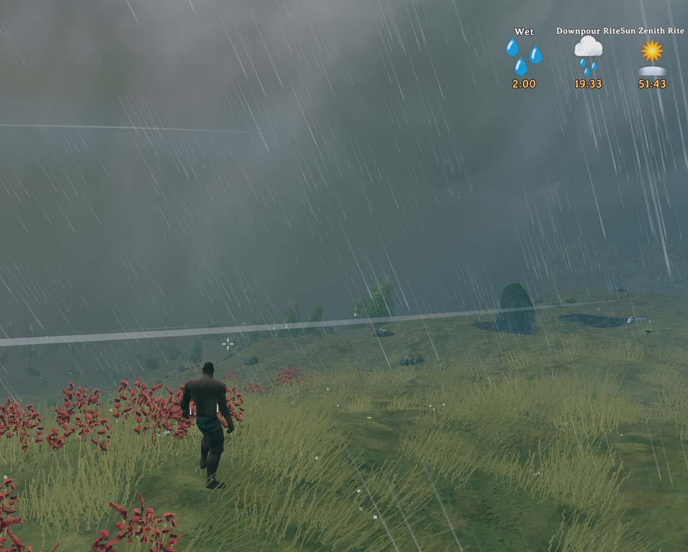
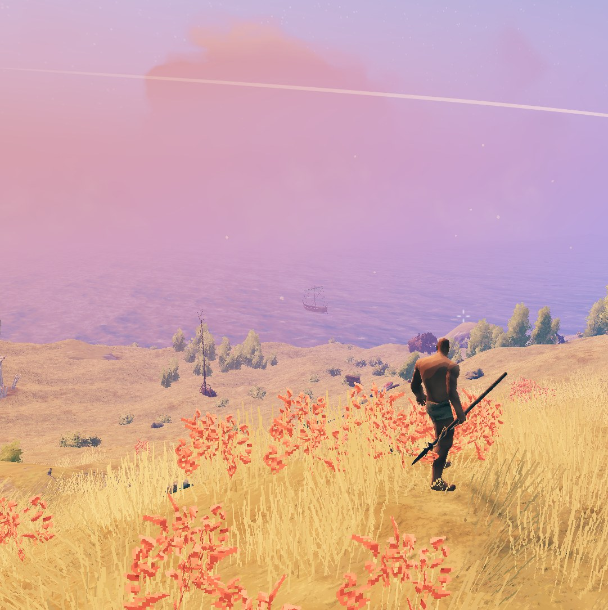
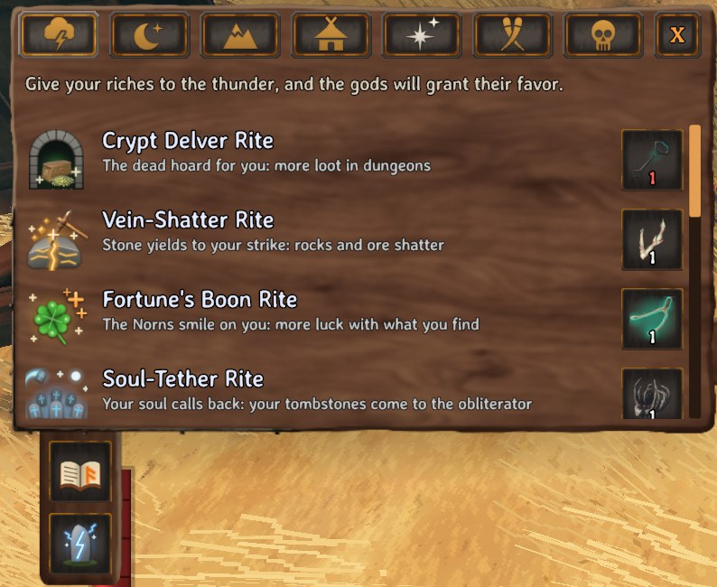
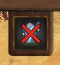
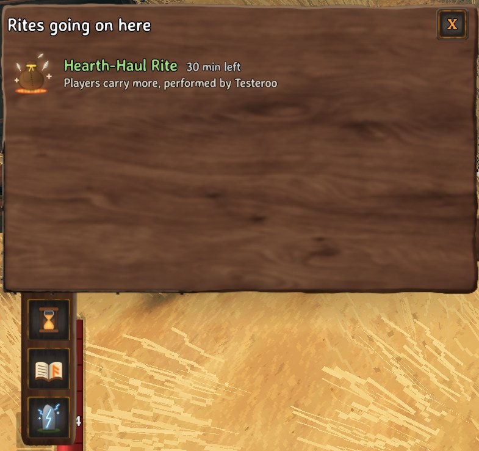
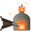
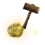
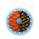

# TempestRite

## Tired of the rain? Perform a rite and change it!

Some days Valheim just won't stop raining. Drop **2 surtling cores** into the obliterator, pull the lever, and the **Clear Sky Rite** clears the skies for everyone. **62 rites in all:** bend the weather, hold back the night, grow crops twice as fast, keep wolves out of your yard, bless yourself before a hard trip, or call a fight to the obliterator for treasure.

Every rite shows as a status that counts down the time left, and each biome gets the weather its own way.

---

### 📸 Screenshots

**Rain or shine, your call.** One item in the obliterator and the sky changes for everyone.

	
	

**The rites page.** Open the obliterator to see every rite you know, its item and how many it needs. Click an item to put it in.

	

---

### 🎮 How to use it

1. Build an **obliterator** and open it. Click the rune stone on the flap under it to **turn its rites on**  (crossed out red while off, so it just obliterates as usual until then).
2. Put a rite item in as a sacrifice, along with whatever else you want to be rid of.
3. Pull the lever. The thunder takes your sacrifice and the rite takes hold for everyone (a blessing: for everyone standing next to it).

Performing the same rite again starts its time over.

---

### 🧭 Rites

Seven groups, one tab each on the rites page. Every rite is explained in full, with the numbers your server uses, on the **Tempest Rite** page of the in-game **Compendium**.

#### 🌦️ Atmospheric

Weather for everyone, in each biome's own way: snow in the mountains, ash rain in the Ashlands. Cold stays cold: a clear sky never warms the mountains.

| | Sacrifice | Rite | What it does |
| :---: | --- | --- | --- |
|  | **2 Surtling cores** | **Clear Sky Rite** | No rain, snow or fog for **20 minutes**. |
|  | **Copper ore** | **Tempest Rite** | A thunderstorm for **20 minutes**: strong wind and serpent weather. |
|  | **2 Ooze** | **Downpour Rite** | Rain for **20 minutes**, putting out wildfires under open sky. |
|  | **3 Cloudberries** | **Shrouding Rite** | Thick fog for **20 minutes**. |
|  | **3 Crystals** | **Aurora Rite** | A calm clear sky with shimmering auroras at night for **20 minutes**. |
|  | **9 Bone fragments** | **Equilibrium Rite** | Ends the atmospheric rites at once. |

#### 🌞 Celestial

| | Sacrifice | Rite | What it does |
| :---: | --- | --- | --- |
|  | **2 Rubies** | **Sun Zenith Rite** | The sun stays up and it counts as day for **60 minutes**. |
|  | **Silver ore** | **Midnight Rite** | The sun stays down: night creatures, night cold. |
|  | **Dragon tear** | **Gale-Breath Rite** | The wind blows as hard as it can, everywhere. |
|  | **8 Greydwarf eyes** | **Sun-Fall Rite** | Ends the celestial rites at once. |

The clock keeps going underneath: days are counted, crops grow and beds follow the real time.

#### 🧭 Biome Mastery

| | Sacrifice | Rite | What it does |
| :---: | --- | --- | --- |
|  | **Sealbreaker fragment** | **True Sight Rite** | The Mistlands mist fades for **60 minutes**. Off by default. |
|  | **3 Smoke puffs** | **Sootfall Rite** | Ashlands smoke, ash and heat haze settle. Only the look: lava still burns. |
|  | **2 Serpent scales** | **Abyssal Surge Rite** | More serpents, bigger schools of fish and more big ones. |
|  | **3 Guck** | **Nature's Rebound Rite** | Ends the biome mastery rites at once. |

#### 🏡 Domain

These work within **100 m** of their obliterator, and the ones that speed things up **keep working while nobody is there**: come back later and the time has been made up. A ring marks the edge of the area, and the **hourglass** on the obliterator's flap lists the rites going on there, with the time left and who performed them.

	

| | Sacrifice | Rite | What it does |
| :---: | --- | --- | --- |
|  | **9 Wolf fangs** | **Packward Rite** | Creatures shun the area and leave your base alone for **1 hour**. |
|  | **3 Pukeberries** | **Carrion Rite** | Creatures walk to the obliterator, into your traps and pens, for **15 minutes**. |
|  | **3 Roots** | **Verdant Rite** | Crops, saplings and berry bushes grow **twice as fast** for **45 minutes**. |
|  | **2 Bile bags** | **Vat-Boil Rite** | Fermenters and cooking stations work **twice as fast**, and nothing burns, for **20 minutes**. |
|  | **8 Charred bones** | **Pitch-Bellows Rite** | Smelters, blast furnaces and kilns work **twice as fast** for **30 minutes**. |
|  | **10 Eggs** | **Kindred Rite** | Tamed animals breed, grow and hatch **twice as fast** for **60 minutes**. |
|  | **3 Ectoplasm** | **Harrow-Spur Rite** | Creature spawners spawn faster and keep more around, for farming, for **30 minutes**. |
|  | **20 Resin** | **Amber-Mend Rite** | Damaged building pieces repair themselves for **5 minutes**. |
|  | **Majestic carapace** | **Sovereign Ward Rite** | Your buildings take **no damage** from anything for **60 minutes**. |
|  | **3 Black metal scrap** | **Hearth-Haul Rite** | Carry far more, and walking overloaded costs no stamina, for **30 minutes**. |
|  | **20 Wisps** | **Aether-Clear Rite** | A giant wisplight: no Mistlands mist in the area for **60 minutes**. |
|  | **15 Ancient seeds** | **Elder-Sprout Rite** | Tree stumps turn into saplings of the same tree for **5 minutes**. |
|  | **Mechanical spring** | **Sentry-Sight Rite** | Ballistas shoot every hostile creature and never players or pets, for **60 minutes**. |
|  | **2 Proustite powder** | **Taproot-Surge Rite** | Sap extractors, eitr refineries and Yggdrasil roots work **twice as fast** for **60 minutes**. |
|  | **3 Tar** | **Pitch-Seal Rite** | Items on the ground never despawn, for farms, for **60 minutes**. |
|  | **Sulfur** | **Primal-Hearth Rite** | Wisp fountains and eternal pyres fill **twice as fast** for **15 minutes**. |
|  | **3 Embers** | **Hearth-Kindle Rite** | Get Rested by a fire **twice as fast**, and for longer, for **60 minutes**. |
|  | **2 Flint** | **Grounding Rite** | Ends the Domain rites at once. |

#### 🌩️ Blessings

For the players standing next to the obliterator when its thunder strikes: its lightning strikes each of them, harmlessly. Each player keeps their own, and it **ends when they die**.

| | Sacrifice | Rite | What it does |
| :---: | --- | --- | --- |
|  | **Swamp key** | **Crypt Delver Rite** | Dungeon chests hold **more loot** for **45 minutes**. |
|  | **3 Freeze glands** | **Glacial Satiety Rite** | Food fades much less for **45 minutes**. |
|  | **Hard antler** | **Vein-Shatter Rite** | Rocks and ore veins **shatter** much faster. |
|  | **2 Mandibles** | **Carapace Temper Rite** | Your gear wears out much slower. |
|  | **Torn spirit** | **Grave-Bind Rite** | Dying costs no skills, and your tombstone shines a beam to the sky, for **1 hour**. |
|  | **Wishbone** | **Fortune's Boon Rite** | Lucky extra items come **twice as often** for **15 minutes**. |
|  | **Dvergr lantern** | **Luminary Rite** | You glow like a lantern for **60 minutes**. |
|  | **4 Chitin** | **Abyssal Draw Rite** | Items fly to you from much farther for **60 minutes**. |
|  | **Dragon egg** | **Fair-Wind Rite** | The wind never blows against your ship. |
|  | **Fuling totem** | **Hush-Felling Rite** | Chopping, mining and gathering make no sound for **60 minutes**. |
|  | **5 Royal jelly** | **Draught-Flush Rite** | Meads come back sooner and last longer for **45 minutes**. |
|  | **Vile ribcage** | **Soul-Tether Rite** | **All your tombstones** come to the obliterator at once. |
|  | **3 different Hides or pelts** | **Tundra Shroud Rite** | No more Wet from rain or Cold at night for **30 minutes**. Freezing still bites. |
|  | **Bonemaw tooth** | **Scald-Drift Rite** | The Ashlands' boiling sea and lava hurt far less for **45 minutes**. |
|  | **Morgen sinew** | **Tether-Lock Rite** | A longer, stronger, faster harpoon line for **30 minutes**. |
|  | **Asksvin bladder** | **Strider-Girth Rite** | Your mount fights on your attack keys for **45 minutes**. |
|  | **Kindled ribs** | **Second-Kindle Rite** | The next blow that would kill you doesn't, and throws foes back. |
|  | **2 Celestial feathers** | **Plume-Ward Rite** | Less fall damage, and one deadly fall forgiven, for **60 minutes**. |
|  | **3 Morgen hearts** | **Morgen-Pouch Rite** | Pocket up to **3 tamed creatures** and let them out anywhere, through portals too, for **30 minutes**. |
|  | **Writhan root** | **Tendril-Draw Rite** | Arrows are often not used up and thrown spears fly back for **45 minutes**. |

#### 🍻 Kinship

For **everyone on the server** at once, wherever they are, each player toasting, roaring or cheering where they stand. Each player then waits a while before the same rite can reach them again.

| | Sacrifice | Rite | What it does |
| :---: | --- | --- | --- |
|  | **3 Tasty mead** | **Skål Rite** | Everyone is **Rested** for **10 minutes**. |
|  | **Ymir flesh** | **Sky-Call Rite** | Everyone's **forsaken power** is ready again. |
|  | **Sharpening stone** | **Anvil-Spark Rite** | Everyone's gear is **repaired**, no workbench needed. |
|  | **A feast** (any) | **Eldhrímnir Rite** | Every food everyone has eaten is **fresh again**. |
|  | **Anniversary tankard** | **Rally-Horn Rite** | A call to everyone: answer it (**Y**) to be brought to the obliterator, or refuse it (**N**). |

#### ⚖️ Reckoning

Fights at the obliterator, under a **shield bubble** nobody can leave or enter until it ends. Each needs a clear place, away from bases, beds and dungeon entrances.

| | Sacrifice | Rite | What it does |
| :---: | --- | --- | --- |
|  | **5 Withered bones** | **Crimson Rite** | **Survive the night.** Raids pour in one after another for **10 minutes** under a blood moon, toughened to match how far you have come. Hold out for **coins for every kill**. |
|  | **3 different Boss trophies** | **Ragnarök Rite** | **A boss rush.** Bosses you have slain rise again, each brought up to the strongest one you have all beaten. Bring them all down for **treasure**. |
|  | **One of Hildir's chests** | **Hoard-Bane Rite** | **Someone wants their chest back.** Its owner comes shielded, with elite guards around the arena. Break the shield, win the fight, and take **coins, valuables and upgrade idols**. Lose and the chest waits for another try. |
|  | **3 Scrap iron** | **Sanctuary Rite** | Ends any raid going on, or any of these fights, with no reward. |
|  | **Thunderstone** | **Unmaking Rite** | Weapons, tools and armor sacrificed with it give back **80%** of what they cost. |

Rewards grow with more players. If everyone inside falls or leaves, the fight ends with nothing.

---

### ✨ Good to know

- **🔍 Learned by finding:** a rite shows on the page once you have held its item, the way recipes do. The rest stay a surprise.
- **🧩 Several at once:** rites of different kinds go on together. A new rite only replaces one of the same kind (one weather at a time).
- **🧺 One sacrifice, many rites:** put several rite items in and one pull performs them all.
- **👀 Know before you pull:** looking at the lever shows which rite it will perform.
- **🏰 Special places stay special:** raids, boss fights and dungeons keep their own weather.
- **⏱️ Play time only:** sleeping doesn't shorten a rite, and rites go on after a restart.

---

### 🔧 Configuration

Settings are in `BepInEx/config/JoksterCube.TempestRite.cfg`, or in game with Configuration Manager (F1). The ones most servers change:

| Setting | Default | What it does |
| --- | --- | --- |
| Who Can Change Weather | Anyone | Who may perform rites: `Anyone` or `AdminsOnly`. |
| Domain Rites Radius | 100 | How far Domain rites reach from their obliterator, in meters. |
| Blessings Range | 10 | How close players must stand to receive a blessing, in meters. |
| Affected Biomes | All but Deep North | Where weather rites show. |
| Require Mod On Clients | On | Turn away players without the mod. |

**Every rite has its own section** too, listed by group like the rites page: turn it on or off, change its items, how many it needs, how long it lasts, and more. Per-player settings sit at the end: **Interface** (statuses, hints, messages, shortcuts) and **Effects** (motes, glows, bubbles). Every setting is explained in the config file and in Configuration Manager. Server settings sync to everyone.

---

### 🧩 Multiplayer & Compatibility

- ✅ Works in single player, when hosting, and on dedicated servers.
- 🔒 **Needed on the server and on every player**, in the same version. Players without it are turned away and told why (**Require Mod On Clients** lets them in, with the normal weather and no rites).
- 🤝 Players joining later get the rites going on, with the time they have left.
- 🔐 The server decides who may perform rites and keeps them going through a restart.

---

### 🌍 Translations

All in-game texts can be translated. Copy `Translations/TempestRite.English.json` from the mod's folder, translate the texts (not the keys, and keep the `{0}` placeholders), and save it as `TempestRite.<Language>.json` next to it, named after the game's language (`TempestRite.German.json`...). Anything missing stays in English.

---

### 💬 Feedback & Support

Report bugs or suggest improvements on [GitHub](https://github.com/JoksterCube/TempestRite/issues).

---

**Author:** JoksterCube 
**Version:** 1.0.0 
**License:** [GNU GPL v3 or later](https://www.gnu.org/licenses/gpl-3.0.html)
